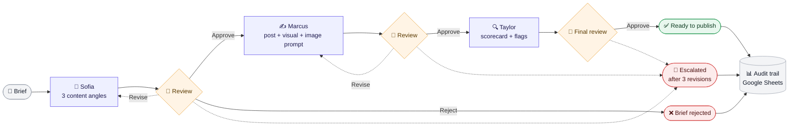

# n8n HITL Content Pipeline

AI can draft social media posts in seconds — but without human control, content drifts away from the brand voice, repeats rejected ideas, and reaches the client unchecked. **This n8n workflow puts three AI agents to work and a human in charge of every decision: nothing moves forward without approval, revision feedback is carried forward, and endless loops are escalated.**

> 🇧🇷 **Resumo em português:** pipeline no n8n com três agentes de IA (estratégia, criação e revisão de qualidade) e aprovação humana em cada etapa. O feedback de cada revisão é repassado aos agentes, e após 3 ciclos de revisão o caso é escalado para uma pessoa. Todo desfecho vai para o Google Sheets com trilha de auditoria.

## How it works

A content brief goes through three specialist agents. After each one, a reviewer receives an email with a form to decide what happens next.

Every review offers three decisions:

| Review | Approve | Revise | Reject |
|---|---|---|---|
| After Sofia | → Marcus | Sofia proposes new angles | Brief rejected and logged |
| After Marcus | → Taylor | Marcus revises the post | Back to Sofia (wrong angle) |
| Final, after Taylor | Ready to publish | Back to Marcus | Back to Sofia (wrong angle) |

Each revision increments a counter for its stage. When a counter reaches `max_revision_cycles` (default **3**), the case is escalated by email instead of looping again.

| Agent | Role | Output |
|---|---|---|
| **Sofia** | Content strategist | Three content angles, steering away from angles already rejected |
| **Marcus** | Creative specialist | Post copy, visual direction, and an image-generation prompt |
| **Taylor** | Quality gate | Scorecard, flags, and a recommendation — instructed to review, not rewrite |

## What makes it production-minded

- **Human-in-the-Loop at every stage** — three n8n form checkpoints; agents never move content forward on their own.
- **Feedback memory** — revision notes and rejected angles are passed into the next agent prompt, so agents can avoid repeating them.
- **State restoration** — after each form submission, dedicated *Restore State* nodes recover the context that form data would otherwise overwrite.
- **Loop protection** — per-stage revision counters with escalation after `max_revision_cycles`.
- **Brand rules as configuration** — voice, preferred and forbidden vocabulary, visual identity, and per-platform rules (LinkedIn, X, Instagram) live in one *Config* node.
- **Audit trail** — every outcome (published, escalated, or rejected) is appended to Google Sheets with the `execution_id`, scores, and the full feedback history.

## Tested scenarios

Validated end to end on n8n Cloud:

- ✅ Happy path — approve at all three stages; record logged and final email sent
- ✅ Revision loops with feedback carried into the next prompt
- ✅ Escalation after 3 revisions
- ✅ Brief rejection and "wrong angle" routes back to Sofia

Not yet tested: what happens when a review form expires (see *Limitations*).

## Setup

**Requirements:** an n8n instance (Cloud or self-hosted) and credentials for **OpenAI**, **Gmail**, and **Google Sheets**. On n8n Cloud, Google credentials connect in a few clicks; on self-hosted n8n, you first need an OAuth client in Google Cloud.

1. **Import** — in n8n, create a workflow, open the `⋯` menu → **Import from File**, and select [`workflow/hitl-content-pipeline.json`](workflow/hitl-content-pipeline.json).
2. **Credentials** — open the nodes flagged in red and select your credentials: OpenAI (3 nodes), Gmail (7 nodes), Google Sheets (1 node).
3. **Emails** — in **Config — Brand + Brief**, replace the four `*@example.com` addresses (reviewer, manager, escalation, client). For a first test, use your own address in all four.
4. **Sheet** — create a Google Sheet whose first row is the header in [`docs/sheet-columns.csv`](docs/sheet-columns.csv), then replace `YOUR_SHEET_ID` in **Output — Log to Sheets**.
5. **Run** — open the **Brief Intake Form** test URL, submit a brief, and follow the review emails.

**Brief fields:** client, platform (LinkedIn, X, Instagram), content type (thought leadership, product announcement, customer story, culture post, data post), optional topic hint, and optional tone note.

## Adapting it to your brand

Everything brand-specific is in **Config — Brand + Brief**: `brand_name`, `brand_voice`, `key_messages`, `language_use`, `language_avoid`, `visual_identity`, the platform rules, and `max_revision_cycles`. Change those values and the three agents follow the new brand. The agent prompts also name the fictional agency (Relay); adjust them if you want a different persona.

The agents use `gpt-4o-mini`. If that model becomes unavailable, select a current one in each **OpenAI** node.

## Limitations

- **Protect the intake form before going live.** The form has no authentication, so anyone with the production URL can submit briefs — and each submission spends your OpenAI credits. Enable **Basic Auth** in the *Brief Intake Form* node before activating the workflow.
- **Review window:** each approval form waits up to **24 hours**. Behavior after the timeout has not been tested — treat an expired review as a manual restart.
- **Email failures stop the run** on purpose: review emails carry the approval link, so continuing silently would leave the workflow waiting for a decision nobody received.
- **Cost:** each run makes at least three OpenAI calls, plus one per revision.
- **No automatic publishing** — the output is a ready-to-publish record, not a post on social media.
- **No image generation** — Marcus writes an image prompt; generating the image is a separate step.

## About the scenario

**Relay** (a B2B social media agency) and **Loopin** (an async video tool for remote teams) are **fictional companies** from the content-automation challenge this workflow was built for.

## License

The workflow logic is released under the [MIT License](LICENSE) © 2026 Tamy Santos.

The fictional brand material for Relay and Loopin — the brand guide in the *Config* node and the brand context in the agent prompts — belongs to the organizers of the content-automation challenge and is **not** covered by this license.
